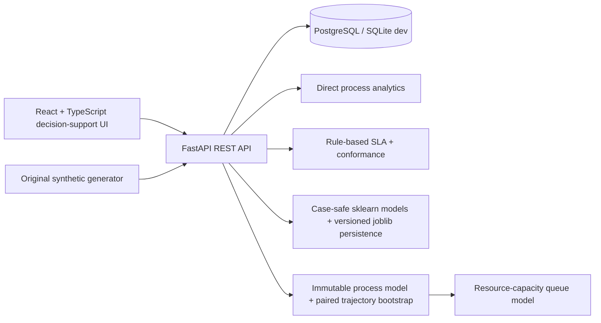

# FlowLens — Counterfactual Process Twin & Transformation Intelligence Platform

FlowLens reconstructs observed business-process execution from event logs, diagnoses variants/bottlenecks/rework/SLA behavior, scores historical active-case snapshots with persisted ML models, and evaluates typed transformation scenarios with **paired counterfactual simulation**. The bundled procurement data is **SYNTHETIC**.

The core workflow is:

```text
EVENT LOGS
  → PROCESS DISCOVERY
  → VARIANTS / BOTTLENECKS / REWORK / SLA / CONFORMANCE
  → CURRENT-STATE DIAGNOSIS
  → TRANSFORMATION OPTIONS
  → PAIRED COUNTERFACTUAL SIMULATION
  → UNCERTAINTY + BASELINE FIDELITY
  → ESTIMATED BUSINESS IMPACT
```

## Architecture



## What is implemented

### OBSERVED analytics
- CSV/JSON import with required-field, timestamp, duplicate, chronology, cost, filename, size and MIME validation.
- Directly derived activities, direct-follow transitions, case percentages, start/end activities and transition delay distributions.
- Exact process variants with frequency/share, cycle time, SLA breach rate and cost.
- Bottleneck evidence using prevalence and elapsed-time contribution. With completion-only logs FlowLens says **observed inter-event delay**, not waiting/processing time.
- If lifecycle `start` / `complete` events exist, bottleneck analysis separates **queue wait** from **processing duration**.
- Rework analysis reports repeated activities and **observed repeat span**; it does not call elapsed repeat span labor overhead.
- Process, activity and segment SLA rules plus observed elapsed-duration contribution for breached cases.
- Heuristic sequence conformance with skipped/unexpected/wrong-order/loop evidence. It is not claimed as formal token replay.

### SIMULATED transformation intelligence
- Typed Pydantic actions: `ActivitySpeedup`, `RemoveActivity`, `AddResourceCapacity`, `AutomateEligibleCases`, `ParallelizeActivities`, `RouteCases`, `ChangeSLA`, `ChangePriorityRouting`.
- Immutable baseline model. Scenario transforms operate on copied trajectory state.
- **Common random numbers / paired runs**: each Monte Carlo run samples one cohort and evaluates baseline and proposed against the same sampled cases.
- Strict no-op behavior: with zero actions, paired baseline/proposed outcomes are exactly equal within floating-point tolerance.
- Historical trajectory bootstrap preserves case-level correlations, variants and heavy-tail behavior better than independent step sampling.
- Resource-capacity scenarios use an explicit finite-capacity queue calculation. When lifecycle service time is unavailable, a documented service-time proxy is used instead of directly dividing cycle time.
- Parallelization of adjacent independent activities uses `max(duration A, duration B)` rather than their sequential sum.
- P10/median/P90 uncertainty for cycle-time and SLA deltas.
- **SIMULATED 30-day completion volume** is counted over a fixed 720-hour horizon under Poisson arrivals calibrated from historical case-start timestamps. A separate paired random stream makes this estimate independent of the cycle-time analysis `cohort_size`; the same arrivals and trajectory templates are used for baseline and proposed branches. This is not a maximum system-capacity claim.
- Baseline-fidelity report compares observed vs simulated mean/median/p90/p95 cycle time, SLA compliance, top variant mix and transition-delay distributions. LOW fidelity emits a warning.

### PREDICTED active-case risk
- SLA classifier + remaining-time regressor.
- **Case-safe time-aware split**: unique case IDs are ordered by case start, split 80/20, and only then are multiple prefixes generated. Train/test case IDs cannot overlap.
- Persisted/versioned classifier, regressor, feature schema, metrics, dataset ID and training cutoff.
- Prediction endpoints load persisted internal models; they do not retrain on every inference request and do not accept arbitrary uploaded joblib files.
- Active cases are historical snapshots: a case must have started by the cutoff and not completed by the cutoff. Features use only events at or before the cutoff.

### ESTIMATED business value
FlowLens keeps lead time and labor effort separate:
- Time-to-completion value requires an explicit `value_of_faster_completion_per_hour` assumption.
- Labor savings require explicit processing-effort minutes saved by automation.
- SLA cost avoidance requires a supplied breach cost.
- Rework savings require an explicit rework-cost assumption and a modeled rework reduction.
- Automation/implementation costs are separate configurable assumptions.

Cycle-time reduction is **never automatically multiplied by labor cost**.

## Frontend pages

1. Overview
2. Process Map
3. Variants
4. Bottlenecks & Rework
5. SLA & Conformance
6. Active Case Risk
7. Transformation Lab
8. Scenario Comparison
9. Business Impact
10. Model Evaluation
11. Data Quality
12. Assumptions / Limitations

The process map is an interactive SVG graph rather than JSON. Variants are rendered as activity-path cards. The Transformation Lab builds typed scenarios for activity speedup, activity removal, resource capacity, selective automation, adjacent-activity parallelization, structured conditional routing, priority routing acceleration, and scenario SLA override. Structured conditions support only `priority`, `value`, `customer_type`, `region`, `department`, and `channel`; `risk_category` is intentionally not exposed because it is not a baseline case attribute. Parallelization and routing are validated by the backend against the loaded process; invalid structures return a visible validation error instead of silently running.

The Business Impact page exposes **ILLUSTRATIVE USER INPUTS** for cases/month, labor rate, activity processing effort, SLA-breach cost, rework cost, automation cost, implementation cost, and optional faster-completion value. OBSERVED, SIMULATED, PREDICTED, ESTIMATED and SYNTHETIC terminology is kept separate in the UI.

## Event schema

Required: `case_id`, `activity`, `timestamp`.

Optional: `resource`, `department`, `cost`, `status`, `channel`, `customer_type`, `priority`, `region`, `value`, `lifecycle`.

UTC is used internally. If `lifecycle` is absent, inter-event timestamps are not mislabeled as pure waiting/processing time.

## Local setup

Python 3.12+:

```bash
python -m venv .venv
# Windows: .venv\Scripts\activate
# macOS/Linux: source .venv/bin/activate
pip install -r requirements.txt
python data/generator/generate.py --cases 500
uvicorn backend.app.main:app --reload
```

Frontend:

```bash
cd frontend
npm install
npm run lint
npm test
npm run build
npm run dev
```

Open `http://localhost:5173`, import `data/sample/synthetic_procurement.csv`, then use the pages above.

### Dependency reproducibility
Python direct dependencies remain exact-version pinned in `requirements.txt`. `requirements.lock.txt` records the exact verified runtime dependency graph available in the final environment; PostgreSQL/lint/type-check tools that were unavailable in that environment remain exact-pinned in `requirements.txt` and are explicitly marked in the lock file rather than being fabricated as verified transitive resolution.

Frontend direct dependencies are exact-version pinned in `frontend/package.json`. `package-lock.json` could **not** be generated because the npm registry is unreachable from this execution environment, so `npm ci` and the production build cannot truthfully be reported as verified here. See `docs/verification-report.md`.

## Docker

Create `.env` from `.env.example`, replace `POSTGRES_PASSWORD` with a random URL-safe local password, set a long random `ADMIN_API_KEY`, then:

```bash
cp .env.example .env
docker compose up --build
```

The API is exposed on `http://localhost:8000` and the web UI on `http://localhost:5173`.

Compose requires `POSTGRES_PASSWORD`; the same variable is used to construct the API `DATABASE_URL`, so no database password is committed in Compose. If `ADMIN_API_KEY` is absent, destructive admin endpoints are disabled with HTTP 503. There is no default known admin secret.

## Verification commands

```bash
python data/generator/generate.py --cases 500
pytest -q
python scripts/smoke.py
python -m compileall -q backend data tests scripts benchmarks
python benchmarks/benchmark.py
DATABASE_URL=sqlite:///./migration_check.db alembic upgrade head
```

See `docs/verification-report.md` for what was actually executed and what was blocked by the environment.

## Process/simulation methodology

Events are grouped by case and ordered by timestamp. Direct-follow edges come from adjacent completed activities. Exact activity sequences define variants. For counterfactual simulation, FlowLens creates an immutable empirical baseline model from complete historical case trajectories. Each Monte Carlo run samples a cohort once, then evaluates baseline and transformed copies with the same sampled cases. This is a common-random-number design: stochastic sampling noise is paired rather than mistaken for intervention effect.

Resource-capacity actions use a finite-server queue calculation. When event logs do not contain lifecycle start/complete timing, FlowLens cannot infer true service time; the resource scenario therefore uses a visible service-fraction assumption and labels the output modeled queue impact.

The **SIMULATED 30-day completion volume** is not derived from the sampled Monte Carlo cohort and is not `720 / mean cycle time`. FlowLens estimates the historical case-arrival rate from case start timestamps, generates a Poisson arrival stream over a fixed 720-hour horizon plus a bounded warm-up period, bootstraps empirical case trajectories, and counts cases completing inside the measurement horizon. Baseline and proposed branches share the same arrival stream and trajectory draws. The arrival-simulation random stream is independent of `cohort_size`, so changing the number of trajectories used for cycle-time uncertainty does not mechanically scale the completion volume. It represents completions **under calibrated historical arrivals**, not maximum system capacity.

## Model evaluation

`POST /models/{dataset_id}/train` returns and persists actual measured precision, recall, F1, ROC-AUC/PR-AUC when defined, remaining-time MAE, median AE and RMSE, plus train/test case counts and the training cutoff. Metrics are computed at runtime and are not hardcoded.

## Security

- Upload byte limit and rate limit.
- Extension/MIME allow-list for CSV/JSON.
- Filename sanitization; no path traversal persistence.
- UTF-8 parsing; files are parsed, never executed.
- SQLAlchemy ORM persistence.
- Narrow CORS configuration.
- Security headers.
- Destructive endpoint disabled when `ADMIN_API_KEY` is unset; configured keys are environment-only.
- No user-uploaded serialized Python model loading.

## Benchmarks

`python benchmarks/benchmark.py` writes real results to:
- `benchmarks/results/local.json`
- `benchmarks/results/fidelity.json`

The benchmark records environment, event count, import/graph/variant/bottleneck/SLA time, paired Monte Carlo runtime, memory, ML train/inference latency, measured model metrics and FastAPI p50/p95 graph latency. Do not generalize these machine-specific values to other hardware.

## Limitations

- Events are stored as validated JSON per dataset for a compact student deployment. Production-scale event stores should normalize/partition events.
- Conformance is explainable sequence-based checking, not Petri-net token replay.
- Parallelization currently applies to observed adjacent activities in the compact sequence model. The API rejects unobserved pairs, but business independence is still a user/domain assumption.
- Conditional routing is intentionally limited to safe structured predicates and existing observed activities. It changes the next routed activity while preserving the empirical transition delay unless another action changes timing; it is not a general BPMN routing engine.
- Resource service time is an explicit proxy when lifecycle start/complete timestamps are absent.
- SIMULATED 30-day completion volume is an arrival-calibrated fixed-horizon metric. It is cohort-size invariant by construction and remains a model estimate under historical arrival intensity, not a maximum-capacity or guaranteed operational-capacity figure.
- Frontend package installation/build was blocked in this packaging environment by unavailable npm-registry network access. Source syntax was checked, but no false production-build pass is claimed.
- Docker runtime is unavailable in this environment; Compose configuration is included and migration logic is separately checked with SQLite.

## Third-party/public data

The repository does not redistribute third-party process logs. `scripts/download_public_dataset.py` downloads only HTTPS CSV/JSON data that already matches the documented schema and enforces a byte limit. License/attribution review remains the user's responsibility.
